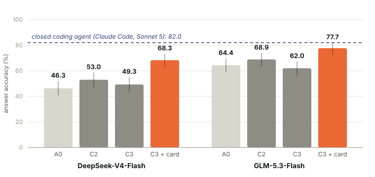
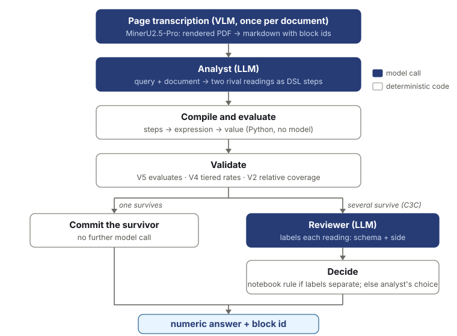

<h1 align="center">Investigating a Guided-Reasoning Pipeline for Open Models Under a Validation–Test Shift</h1>

<p align="center">
  <b>DFM at DocSEM 2026</b> · DocInsights 2026 Workshop @ EMNLP 2026 · Poster DocInsights-48
</p>

<p align="center">
  <a href="https://dyonnatan.github.io/docsem-2026/"></a>
  <a href="https://dyonnatan.github.io/docsem-2026/slides/"></a>
  <a href="paper/"></a>
  <a href="docs/assets/poster.pdf"></a>
  
  
  <a href="LICENSE"></a>
</p>

This repository holds the code, prompts, data and model outputs behind the DocSEM 2026
system paper *DFM at DocSEM 2026: Investigating a Guided-Reasoning Pipeline for Open
Models Under a Validation–Test Shift*.

Open-weight models are cheaper to run and easier to inspect than closed ones, but they are
usually evaluated as they are: one prompt, one answer. Strong results on document-grounded
math usually come from closed models or from open models trained further with
reinforcement learning or fine-tuning. We test a third route: the weights stay frozen and
only what surrounds the model call changes. **Can frozen open-weight models solve
document-grounded math better with this kind of guidance alone?**

The pipeline asks the model for two rival readings of a quantitative passage, written as
short steps in a small DSL, compiles them into arithmetic that Python evaluates, and lets
validators, a reviewer and fixed notebook rules choose between them. It reached 88.5–89.9%
answer accuracy on validation but 51.4% on test. Test documents are about eight times
longer, hold about two dozen problems instead of one, and contain decoys that repeat the
query's words, so the system must first select the passage and only then resolve it. To
measure that regime with known labels we built a **test-like replica** of 300 documents,
released here. On it, citing the wrong passage causes about seven times more errors than
computing the wrong number, and one paragraph of selection guidance gives the largest
gain: answer accuracy rises from 46.3% to 68.3% (DeepSeek-V4-Flash) and from 64.4% to
77.7% (GLM-5.3-Flash) over direct prompting.

<p align="center">
  
</p>

## Takeaways

1. **Target guidance at where the errors are.** A short, targeted instruction can matter
   more than an elaborate reasoning structure.
2. **Structure makes reasoning inspectable, not necessarily better.** Rules rarely
   override the model's own choice: the analyst's preference decided 274 of the 300
   replica answers of the submitted system.
3. **Copies of one model are not independent reviewers.** They tended to agree on the same
   wrong reading (an exploratory observation on 19 decisions).
4. **Scaffolding helps, but the model matters as much as the technique.** GLM-5.3-Flash
   prompted directly outperforms DeepSeek-V4-Flash with the step DSL.

The ranked test submission reached 45.09% joint accuracy (best entry 85.09%). The replica
and the selection guidance were developed after the competition, for analysis only.

## Contents

- [Takeaways](#takeaways)
- [Installation](#installation)
- [Reproducing the paper without API calls](#reproducing-the-paper-without-api-calls)
- [The pipeline](#the-pipeline)
- [Running the pipeline](#running-the-pipeline)
- [The test-like replica](#the-test-like-replica)
- [Repository layout](#repository-layout)
- [Notes on reproduction](#notes-on-reproduction)
- [Citation](#citation)
- [License](#license)

## Installation

The package uses only the Python standard library (3.10 or newer).

```bash
git clone https://github.com/Dyonnatan/docsem-2026.git && cd docsem-2026
uv venv && source .venv/bin/activate      # or: python -m venv .venv
uv pip install -e ".[dev]"                # pytest is the only extra
```

Without installing, every command also runs as `PYTHONPATH=src python -m dfm ...`.

## Reproducing the paper without API calls

All model completions behind the paper's results are in `results/`. The deterministic
part of the pipeline (DSL compilation, validators, notebook rules) rebuilds every released
prediction from them, and the scoring code recomputes the tables.

```bash
dfm tables                                  # Tables 4 and 5, Appendix C and E, Section 6
dfm replay configs/replica/*.json configs/dev200/*.json
dfm replica build --out /tmp/replica        # regenerates data/replica byte for byte
pytest                                      # 31 checks, about 5 seconds
```

`dfm tables` prints, among others, the replica table of the paper:

```text
  arm                           n  answer        95% CI  evid.  joint
  DeepSeek A0                 300    46.3 [40.8, 52.0]   46.0   40.3
  DeepSeek C2                 300    53.0 [47.3, 58.6]   60.3   50.7
  DeepSeek C3                 300    49.3 [43.7, 55.0]   46.0   38.7
  DeepSeek C3+card            300    68.3 [62.9, 73.3]   76.0   63.7
  GLM A0                      295    64.4 [58.8, 69.7]   70.8   63.1
  GLM C2                      299    68.9 [63.4, 73.9]   58.5   53.2
  GLM C3                      300    62.0 [56.4, 67.3]   63.0   51.7
  GLM C3+card                 300    77.7 [72.6, 82.0]   80.3   67.0
  Claude Code (Sonnet 5)      300    82.0 [77.3, 85.9]   94.0   82.0
```

| Paper | Command | Source in `results/` |
| --- | --- | --- |
| Table 4, dev200 column | `dfm tables` | `dev200/*/` |
| Table 5, replica | `dfm tables` | `replica/*/` |
| Table 6, portal scores | (scored by the organisers) | `submissions/` |
| Section 6, selection vs resolution | `dfm tables` | `replica/c3c-deepseek/` |
| Section 6, decision paths of C3C | `dfm tables` | `*/c3c-deepseek/` |
| Appendix A, replica and validity gate | `dfm replica build`, `dfm replica gate` | `data/replica/` |
| Appendix C, paired tests | `dfm tables` | `replica/*/` |
| Appendix E, card variants | `dfm tables` | `replica/c3-card-full-*/` |
| Appendix G, prompts | (verbatim files) | `prompts/` |

## The pipeline

<p align="center">
  
</p>

Stage 1 converts each rendered PDF page to markdown with MinerU2.5-Pro and keeps the
printed block identifiers. It ran once; its output is in `data/extraction/`. Stage 2 is
the subject of the paper. Each variant changes one design decision relative to the
previous one:

| Variant | What the model writes | What decides the answer |
| --- | --- | --- |
| **A0** | `{answer, evidence}` | the model |
| **C2** | two rival readings, each an arithmetic expression | Python evaluates them; validators V5, V4 and V2 reject readings; a unique survivor wins, otherwise the model's preferred reading |
| **C3** | the readings as step lists in a small DSL (`obs`, `assume`, `therefore`, `return`) | the compiled value of the surviving or preferred reading |
| **C3C** | C3, plus a reviewer call that labels each surviving reading with a side from the notebook, a contextual memory of rules for recurring ambiguities | a notebook rule when the labels separate the readings, otherwise as in C3 |
| **+ card** | C3 with one paragraph on how to recognise decoy passages | as in C3 |

Reimplementations of PAL, SatLM and ArgLLM in the same harness did not outperform C3 in an
exploratory test on hard cases. Of the 14 open-weight models tried during exploration, only
DeepSeek-V4-Flash (the submitted pipeline) and GLM-5.3-Flash (added for the replica) reached
the main results; Appendix D of the paper and the [project page](https://dyonnatan.github.io/docsem-2026/#models)
list the others and why they were dropped.

A C3 reading, as the analyst writes it and as the runtime compiles it:

```json
{"id": "r1", "steps": [
  {"op": "obs",       "id": "remora_each_in", "value": 6},
  {"op": "obs",       "id": "remora_count",   "value": 2},
  {"op": "assume",    "text": "each of the two remoras measures 6 inches"},
  {"op": "therefore", "id": "total_in", "expr": "remora_each_in * remora_count"},
  {"op": "therefore", "id": "pct", "expr": "total_in / (10 * 12) * 100"},
  {"op": "return",    "expr": "pct"}]}
```

```python
>>> from dfm.derivation import compile_reading
>>> compile_reading(reading)["expression"]
'(((6) * (2)) / (10 * 12) * 100)'        # evaluates to 10.0
```

The code that implements each part:

| Module | Role |
| --- | --- |
| [`dfm/pipeline.py`](src/dfm/pipeline.py) | the four variants; model calls kept apart from the deterministic steps |
| [`dfm/derivation.py`](src/dfm/derivation.py) | C3 DSL compiler and the `base * fraction` completion used by C3C |
| [`dfm/readings.py`](src/dfm/readings.py) | evaluation, validators V2/V4/V5 and selection (C2 runtime) |
| [`dfm/notebook.py`](src/dfm/notebook.py), [`dfm/reviewer.py`](src/dfm/reviewer.py) | C3C notebook rules, reviewer call and deterministic closing |
| [`dfm/blocks.py`](src/dfm/blocks.py) | block parsing and the evidence post-processing of the test submission |
| [`dfm/replica.py`](src/dfm/replica.py) | replica generator and validity gate |
| [`dfm/scoring.py`](src/dfm/scoring.py), [`dfm/tables.py`](src/dfm/tables.py) | scoring, Wilson intervals, exact McNemar tests, paper tables |

## Running the pipeline

Every arm of the paper has a configuration in `configs/` with its prompt, model, sampling
and provider routing. Models are called through [OpenRouter](https://openrouter.ai).

```bash
cp .env.example .env                        # then set OPENROUTER_API_KEY
dfm run configs/replica/c3-card-glm.json --limit 20
dfm run configs/replica/c3c-deepseek.json   # all 300 replica tasks
dfm score runs/replica-c3c-deepseek/predictions.jsonl replica
```

`dfm run` writes one record per task (prediction, decision path and every completion) to
`runs/<arm>/records.jsonl` and resumes where it stopped. Each replica arm cost between
US$0.10 and US$2 in API fees in our runs. Sampling uses temperature 1.0, so a new run
reproduces the reported numbers up to sampling noise (95% intervals are about ±5 points
on 300 tasks); `dfm replay` reproduces them exactly from the released completions.

To run on the official splits, download the DocSEM data from the organisers (see
[`data/README.md`](data/README.md)); the stage-1 text of all train, validation and test
documents is already included.

## The test-like replica

`data/replica/` holds 300 documents built from the test template around training
problems whose answer and evidence are public:

- about 22 competing problems per document, opaque block identifiers and the three
  separators seen in test;
- decoys that repeat the query's anchor words inside a counting template, in 206 of the
  300 documents;
- "outcome records" that print the final value of about 70% of the non-target cases,
  never of the target.

```json
{"instance_id": "synth_000001", "user_query": "For this revised scenario, according to the brief's quantitative scenario concerning school and hours, what final value is required?"}
{"instance_id": "synth_000001", "answer": "50", "evidence": ["645"], "source_task": "task_000122"}
```

The replica is easier than test (36k against 43k characters per document, no decimal
answers) and 65 of its 300 targets come from dev200, so it is not independent of
development data. The submitted pipeline's answer accuracy on the replica (49.0%) is
within three points of its first test submission (51.4%).

## Repository layout

```text
src/dfm/          the package (standard library only)
configs/          one JSON file per arm: replica/ and dev200/
prompts/          every prompt, verbatim, and the two notebook versions
data/
  replica/        the test-like replica: tasks, labels, 300 markdown documents
  docsem/         official task files and training labels (UPL-1.0)
  extraction/     stage-1 markdown of all train and val documents; test as .tar.xz
  splits/         dev200 and hard-18 instance ids
results/
  replica/        predictions and completions of every replica arm, and the closed agent
  dev200/         predictions and completions of every dev200 arm
  submissions/    the files submitted to the validation and test portals
paper/            LaTeX source of the paper (revised version)
docs/             project page (GitHub Pages), talk slides, figures and poster
scripts/          figure generation
tests/            unit and end-to-end tests
```

## Notes on reproduction

[`docs/REPRODUCING.md`](docs/REPRODUCING.md) describes which configuration produced each
released output. The paper in `paper/` is the revised version of November 2026, and the
poster and slides in `docs/` were regenerated from it; the note also lists the figures it
corrects relative to the camera-ready version and to the material presented at the
workshop. In short:

- Every prediction in `results/` is rebuilt exactly from its completions (17 arms,
  4,600 tasks), and the replica is regenerated byte for byte.
- The replica table, its paired tests, the decomposition of Section 6, the dev200 counts
  and the decision paths of C3C match the revised paper.
- The poster and the talk presented at the workshop showed an earlier decomposition
  (52.9% selection and 7.6% resolution errors on 291 tasks, from the C3 outputs before
  nine parse failures were re-run). The paper, the poster and the slides released here
  use C3C on all 300 tasks: 54.0% and 7.3%.
- The validity-gate script used before the replica runs was not preserved; the
  reimplementation here gives keyword 27.9% against chance 29.6% (n = 276), and the
  revised paper reports these figures.

## Citation

```bibtex
@misc{maia2026dfm,
  title        = {{DFM} at {DocSEM} 2026: Investigating a Guided-Reasoning Pipeline for Open Models Under a Validation--Test Shift},
  author       = {Maia, Dyonnatan Ferreira},
  year         = {2026},
  howpublished = {\url{https://github.com/Dyonnatan/docsem-2026}},
  note         = {Non-archival poster, DocInsights 2026 Workshop at EMNLP 2026}
}
```

The DocSEM data derive from GSM-SEM (Singh et al., 2026, arXiv:2605.07053).

## License

The code is released under the [MIT License](LICENSE). The DocSEM task files, training
labels and everything derived from the DocSEM documents (stage-1 extractions and the
replica) are covered by the Universal Permissive License 1.0 of the original data; see
[`data/LICENSE-UPL.txt`](data/LICENSE-UPL.txt).
